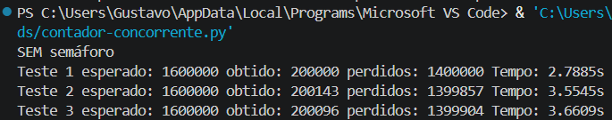
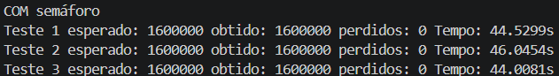
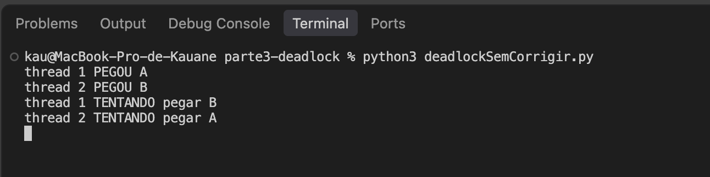
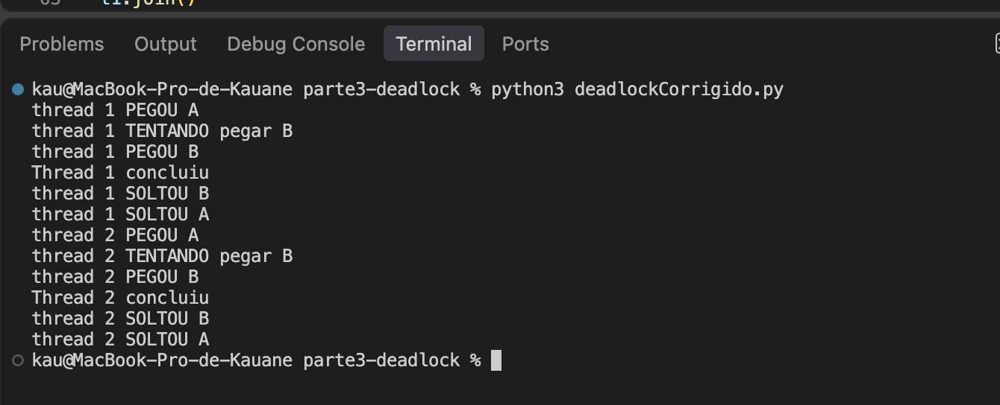

Relatório Técnico:

Parte 2 — Threads e semáforos

Na versão sem sincronização perdemos elementos porque ocorreu a condição de corrida.Uma thread lê o valor do contador, ao chegar no comando time.sleep(0) , a execução interrompe essa thread e permite que outra thread leia o mesmo valor do contador. Assim, as duas threads calculavam o valor do contador, e uma acabava sobrescrevendo a outra ao gravar o resultado.

A versão com semáforo é correta porque o semáforo garante que apenas uma thread por vez acessa a seção crítica, enquanto a outra thread aguarda a primeira thread, isso impede que uma sobrescrita ocorra com base em um valor antigo.Nos testes realizados, não tivemos nenhuma perda e conseguimos ter os 1.600.000 esperados.

Trade-off de throughput: na versão sem o semáforo, as threads foram executadas mais rápido, porém milhares de incrementos foram perdidos. Já na versão com o semáforo, as threads demoraram mais para executar devido que apenas uma thread poderia modificar o contador por vez , enquanto as outras threads aguardavam,não havendo nenhuma perda de incrementos nessa versão. O time.sleep(0) também contribuiu com essa lentidão, já que a thread acessava o semáforo e logo encontrava o time.sleep(0), então ela entregava a execução para outra thread, que tenta acessar o semáforo, mas encontra o bloqueio do semáforo devido a uma thread já estar ocupando ela, logo a primeira thread volta assumir e gera esse aumento de tempo na fila de espera das threads e reduz o throughput.

No conceito de visibilidade, outras threads conseguem visualizar um novo valor do contador quando uma thread atualiza ele. No conceito de ordenação, estamos estabelecendo uma sequência correta que foi programada, com o semáforo liberando apenas uma thread na seção crítica .O python utiliza as barreiras implícitas para controlar o acesso à memória compartilhada, com os comandos acquire() e o release() permitindo e liberando esse acesso para as threads atualizarem o contador e visualizarem o contador atualizado, com o valor da atualização feita por uma outra thread anteriormente.

PARTE 3 - DEADLOCK
O cenário desse problema representa o travamento das threads por espera circular. Ou seja, uma thread segura o recurso que a outra precisa para continuar.
Isso acontece pela combinação das quatro condições de Coffman (exclusão mútua, espera circular, manter-e-esperar, não-preempção).
No exemplo sem correção, é criado dois locks (Lock A e Lock B), onde cada um possui apenas um dono por vez, e duas funções para representar as threads trabalhando.
Quando uma thread está com o lock de um recurso, outras threads não conseguem acessá-lo. Portanto, a Thread 1 segura o lock A e espera o B, que está com a Thread 2. A Thread 2 segura o lock B e espera o A, que está com a Thread 1, criando uma espera circular. Como ninguém retira o recurso a força, ocorre o deadlock.

Já no exemplo corrigido, foi possível contornar o erro quebrando a espera circular utilizando hierarquia de recursos.
Isso foi possível fazendo ambas as threads tentarem pegar o mesmo recurso primeiro. Ou seja, pegar o lock A antes do lock B. Desse jeito, a thread que não consegue o A espera sem segurar nenhum lock, então a outra consegue terminar e liberar tudo.

